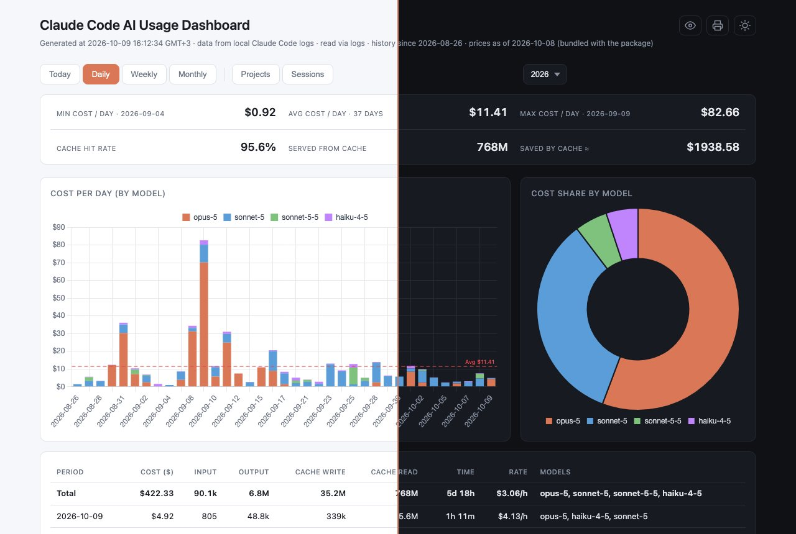
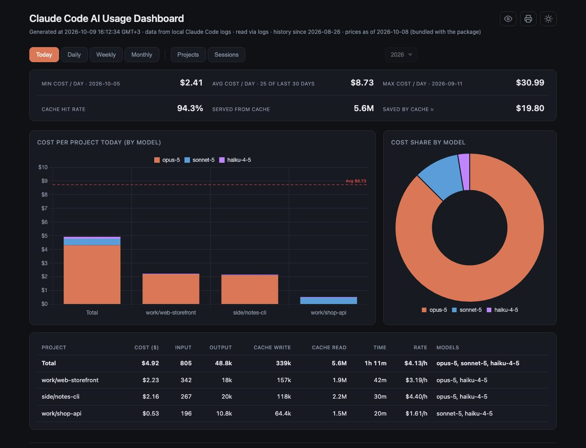
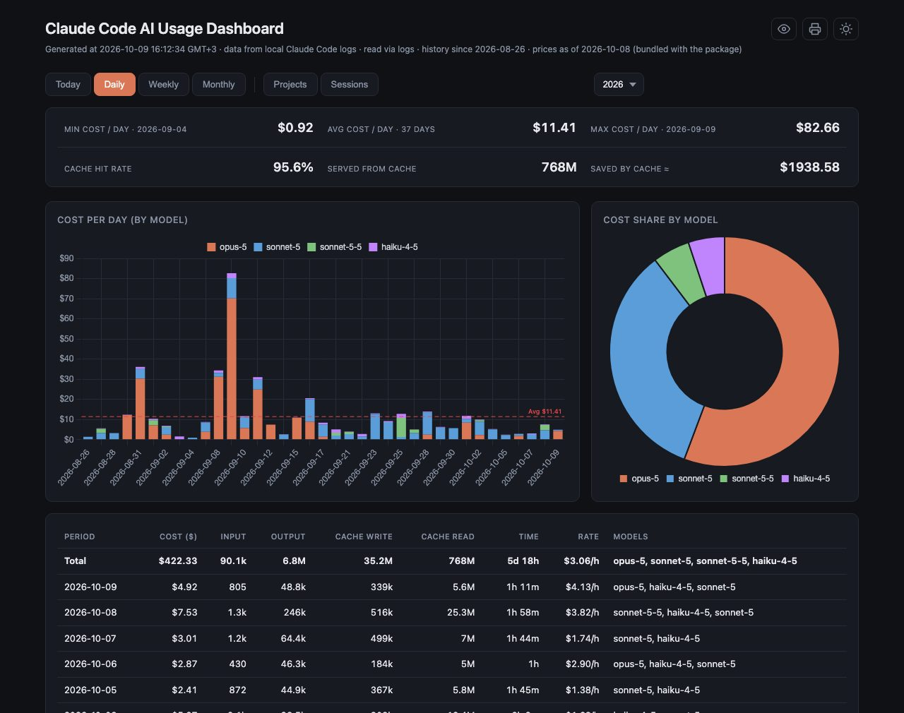
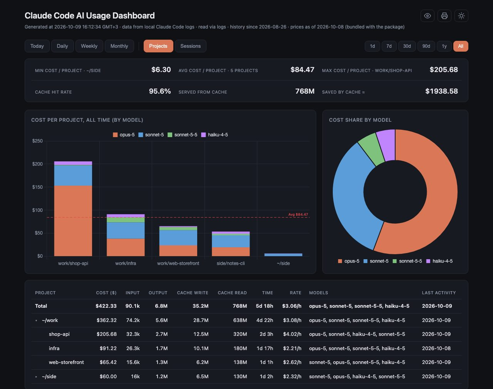
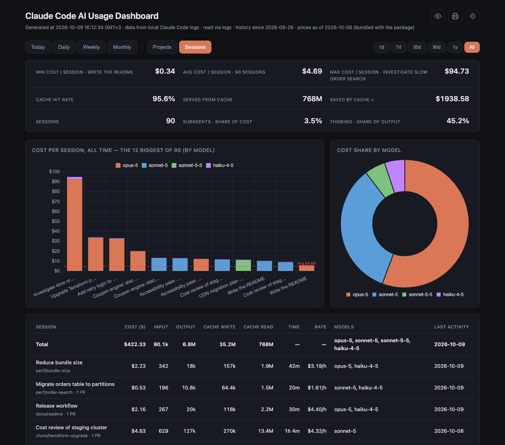
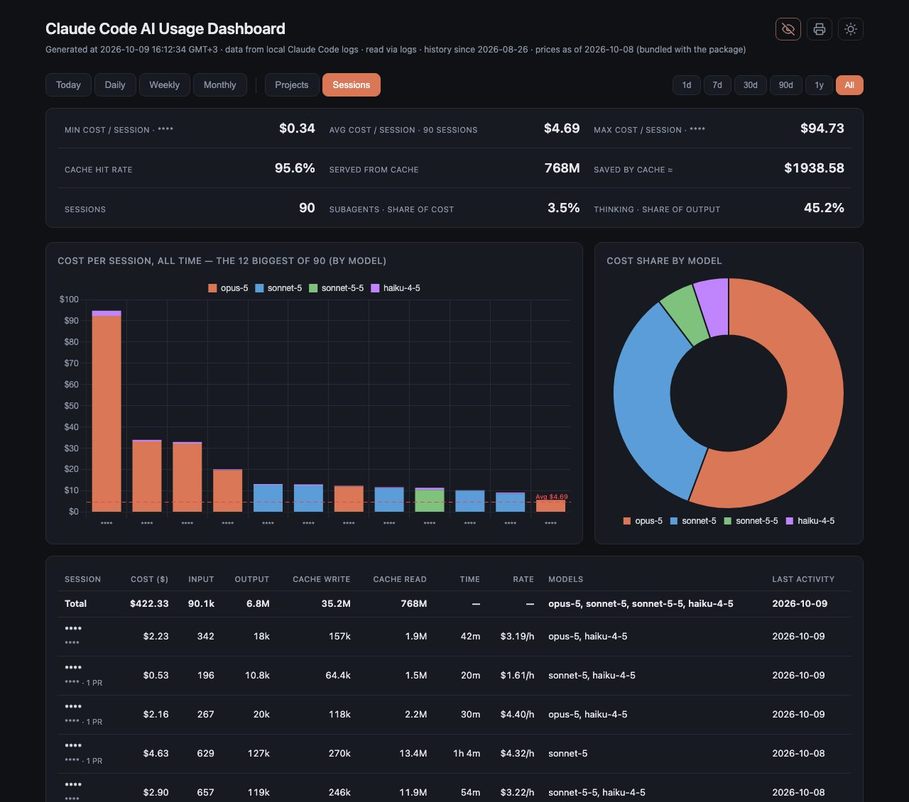
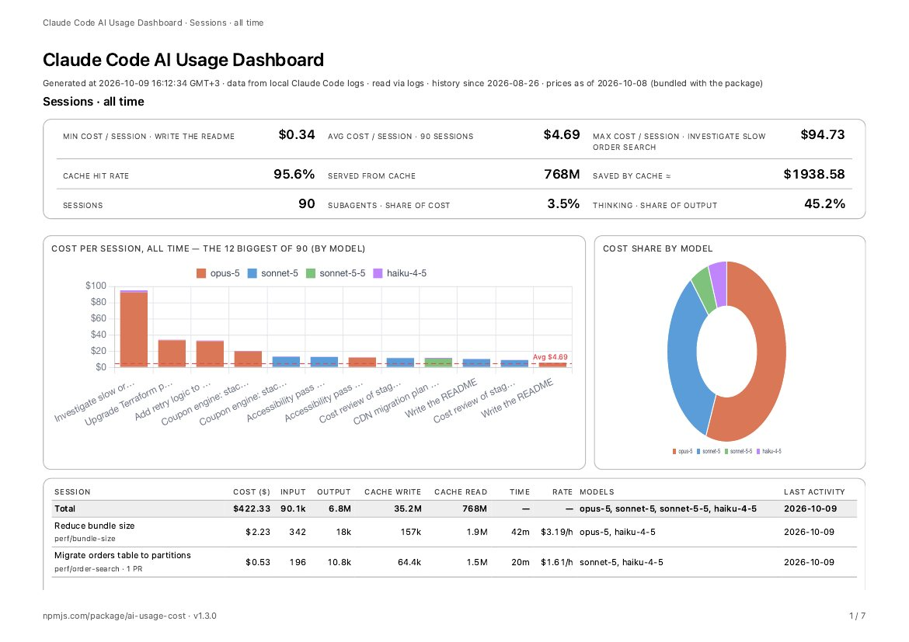

# ai-usage-cost

> Formerly **ccusage-ui-dashboard** (npm releases up to 1.2.0). The old package is deprecated and points here; only the name changes — same options, same `config.json`, same `history.json`.

A local dashboard for **Claude Code** usage and cost — by day, week, month, project and session (with its git branch and pull requests) — as **one offline HTML file**. It also tells you how long you actually worked (`$/hour`), how much the prompt cache saved, and keeps your history past Claude Code's 30-day transcript cleanup.

> **Main feature:** type `/<prefix>-usage` inside any Claude Code session and get an inline cost & token summary _right in the chat_, plus the full visual dashboard opens in your browser — all without leaving your terminal.



<sub>One dashboard, two themes: the left half is the light theme, the right half the dark one (same data). Every screenshot in this README uses invented projects and numbers.</sub>

The dashboard runs entirely on your machine. It reads the local Claude Code transcripts
(`~/.claude/projects/**/*.jsonl`) with a built-in reader — [`ccusage`](https://github.com/ryoppippi/ccusage)
is only an optional fallback — embeds the parsed data into a self-contained HTML file, and opens it in your browser.
No server, no telemetry, no external API calls except one daily download of the public price table (opt out with
`"priceRefresh": "off"`) — Chart.js is bundled into the generated file, so the dashboard also works offline.

## Features

**Views**
- **Today · Daily · Weekly · Monthly** with a year drop-down (right of the tabs, from all years in your data) and the week start following your locale (or `config.json`). Today breaks the day down **by project**: one table row and one stacked bar per project (the folder each message was written from), plus a **Total** bar to compare with the average line.
- **Projects** — everything spent per project for 1 day / 7 days / 30 days / 90 days / 1 year / all time, as an expandable **folder tree**: a row adds up everything below it, chains of folders are folded (`~/ok/code_p/app`), a folder with usage of its own lists it first as ".. (this folder)", and branches holding at least 20% of the spend start open; click a row to open or close it.
- **Sessions** — one row per Claude Code session, the unit of work (its title, cost, tokens, active time, `$/h`, last activity), with the git branch and the number of linked pull requests as a grey line under the title (details on hover). Shows how much of the cost **subagents** caused and how much of the output was **thinking**. Needs the built-in reader; titles are optional (`sessionTitles`).
- **Total row** at the top of every table; **Min / Avg / Max** cards with the date (or the project / session) of the cheapest and most expensive row; a **stacked bar chart by model** with a dashed red **average line** and stable model colours; a **doughnut** of cost by model; token columns shown compactly (`10.2k`, `4.3M`, `1.4B`, exact value on hover).

**Measures**
- **Time** — how long you actually worked, in every table (`45m`, `3h 12m`, `5d 3h`; a day is 24 hours of activity). It is *active* time: the gaps between consecutive events of a session count as work when they are at most 10 minutes (`idleMinutes`), longer pauses count as being away; parallel sessions are counted once. `—` = not measured, `≥` = some days of that period were not measured.
- **Rate** — what an hour of work cost (`$12.34/h` = Cost ÷ Time). Only the cost of days whose time was measured is divided, so a period with unmeasured days is not skewed (it is marked `~`); `—` when there is no time to divide by or less than a minute of it (5 s of work and $0.16 would read $115/h). A folder row divides its summed cost by its summed time, so when sessions in sibling folders overlapped its rate is a little lower than the Total's.
- **Prompt cache** — hit rate, tokens served from the cache and an estimate of what the cache saved (at today's prices; writes to the cache cost a little more than plain input, so a write-heavy period can show a negative number).
- **Costs priced correctly** — cache writes to the 1-hour cache at the 1-hour rate, prices from LiteLLM's public table refreshed once a day (the bundled table is the offline fallback, the page shows the date the prices are from), and a model without a known price is flagged instead of silently counting as $0. Figures are **list prices**: contracted or discounted rates and the 1.1× US-only-inference multiplier are not known to the logs.

**Keeping and sharing**
- **Long-term history** — Claude Code deletes transcripts older than 30 days (`cleanupPeriodDays`); the dashboard keeps its own ledger (`history.json`: tokens and cost per 15-minute bucket, project and model, plus sessions), so past months stay in the charts and a later price change never rewrites what you already spent.
- **Print** — a printer button (or Ctrl/Cmd+P) prints the tab on screen on a white A4 landscape page whatever the theme: heading, the tab and its period (the controls that carry them are not printed), the figures, both charts redrawn in a light palette, and the table with its header repeated on every page and no row cut in two. Every page has a running header (tool · tab · period) and a footer with the npm address of the package and the version, and "page / pages". Privacy mode applies to what is printed. The running header, footer and page numbers need a browser that supports `@page` margin boxes (Chrome / Edge 131+); others print without them. Tip: switch on "Background graphics" in the print dialog to keep the shading of the Total row.
- **Privacy mode** — an eye button next to the theme toggle replaces project names, session titles, branches and pull request repositories with `****` (numbers and structure stay), so you can show the dashboard without showing what you work on.
- **`--doctor`** — a read-only health check of the setup (log folders, transcript retention, ledger, prices, config).
- **Built-in log reader** — no `ccusage` and no network needed; verified against ccusage cell by cell on real logs.
- **Ready for more AI tools** — the heading reads "<tool> AI Usage Dashboard" and, once a second tool's logs are readable, a drop-down next to the theme toggle switches the whole dashboard between them (tabs a tool cannot fill are hidden). Only Claude Code is read today; adding another tool is one file (see [Adding another AI tool](#adding-another-ai-tool)).
- Light / dark theme toggle, an inline markdown summary printed to stdout (Today / Last 7 days / This month / All time + top models), generation time in your local time zone, works offline with only Node.js.

## What it looks like

**Today, by project** — one stacked bar per project plus a **Total** bar to read against the average line; the figures block above has min / avg / max, the prompt cache and, on the Sessions tab, subagents and thinking.



**Daily** (Weekly and Monthly are the same view by week and month) — cost per day by model, the model split, and a table with tokens, **time** and **rate ($/h)**.



**Projects** — an expandable folder tree: a folder adds up everything below it, with period chips from 1 day to all time.



**Sessions** — one row per Claude Code session (newest first) with its title, the git branch and the number of pull requests under it, cost, time and rate.



**Privacy mode** — the eye button replaces names (session titles, branches, projects, repositories) with `****`; numbers and structure stay, so you can show the dashboard without showing what you work on.



**Print** — the printer button (or Ctrl/Cmd+P) prints the tab on screen on a white A4 landscape page, with a running header, the package address and page numbers in the footer.



## Requirements

- Node.js ≥ 18 and a modern browser. Everything here is plain Node.js — no `bash`, `python3`, `npx` or `ccusage` needed for the default mode. Developed and tested on macOS; Linux and Windows use the same code but are untested.
- Optional: [`ccusage`](https://github.com/ryoppippi/ccusage) (12.4.0 – 20.x, resolved through `npx`; a globally installed one is used first) — only used when `source` is `ccusage`, or as the fallback when no usage records are found in the logs.
- Claude Code CLI installed (so that `~/.claude/` exists and the skill is picked up).

## Installation

### Option A — one-shot via `npx` from npm (recommended)

No clone required. Installs from the npm registry:

```bash
npx ai-usage-cost
```

Pass the prefix non-interactively:

```bash
AI_USAGE_PREFIX=ai npx ai-usage-cost
```

### Option B — one-shot via `npx` from GitHub

Pulls the package straight from GitHub — useful before an npm release:

```bash
npx github:okrasn/ai-usage-cost
```

Pin a tag/version if you want reproducibility:

```bash
npx github:okrasn/ai-usage-cost#v1.0.0
```

You can also pass the prefix non-interactively:

```bash
AI_USAGE_PREFIX=ai npx github:okrasn/ai-usage-cost
```

### Option C — clone and run setup

```bash
git clone https://github.com/okrasn/ai-usage-cost.git
cd ai-usage-cost
npm run setup
```

Either path triggers the same flow. `setup` first prompts for a
**prefix** (default `ai`, so the skill is invoked as `/ai-usage`;
pick anything matching `[A-Za-z0-9_-]+`, e.g. `me` → `/me-usage`). If a skill of this package is already
installed, its prefix is offered instead, so an upgrade keeps the command you type. To skip the
prompt, pass it via env: `AI_USAGE_PREFIX=ai npm run setup`.

Then it runs the full cascade:

1. **`copy-dashboard`** — copies `build.mjs`, `lib/`, `vendor/` and `template.html` into `~/.claude/dashboard/` (or `$CLAUDE_CONFIG_DIR/dashboard/`).
2. **`copy-skill`** — writes the skill to `~/.claude/skills/<prefix>-usage/SKILL.md` (a `disable-model-invocation` skill: only you can run it).

After it finishes, open any Claude Code session and type:

```
/<prefix>-usage    # by default /ai-usage
```

You'll get an inline markdown summary in chat **and** the full visual dashboard
will open in your default browser.

### Step-by-step (if you prefer)

```bash
npm run copy-dashboard          # dashboard files → ~/.claude/dashboard/
AI_USAGE_PREFIX=ai npm run copy-skill    # skill → ~/.claude/skills/ai-usage/SKILL.md
```

The installer itself takes `--dashboard` (only the dashboard files), `--skill` (only the skill; `--command` is a deprecated alias), `--prefix <name>` and `--force`, e.g. `npx ai-usage-cost --skill --prefix ai --force`.

`copy-skill` reads the prefix from `--prefix` or the `AI_USAGE_PREFIX` env var; without
either it prompts interactively (defaulting to a skill (or a pre-1.3 command) previously installed by this package,
or `ai` on a fresh machine; non-interactive runs use that default). The variable is named
`AI_USAGE_PREFIX` deliberately — `PREFIX` collides with npm's own `--prefix` config. (`CC_USAGE_PREFIX`, its name before 1.3.0, still works; `AI_USAGE_PREFIX` wins when both are set.)

It never overwrites a `<prefix>-usage` skill that this package did not install — pick another
prefix, or pass `--force`. A slash command that **this package** installed before 1.3
(`~/.claude/commands/<prefix>-usage.md`) is removed and replaced by the skill. Pass `--force` to either step to reinstall the same version — with npm scripts put it after a separator
(`npm run setup -- --force`); without `--`, npm keeps the flag for itself and the installer just reports "skipping".

### Optional — shell alias

Add to `~/.zshrc` (or `~/.bashrc`):

```bash
alias <prefix>-usage='node ~/.claude/dashboard/build.mjs'
```

Reload the shell, then run `<prefix>-usage` from anywhere to rebuild and open the dashboard.

## Usage

### From the terminal

```bash
node ~/.claude/dashboard/build.mjs                          # rebuild + summary + open browser
node ~/.claude/dashboard/build.mjs --no-open                # rebuild + summary, no browser
node ~/.claude/dashboard/build.mjs --no-summary             # rebuild + open, no summary
node ~/.claude/dashboard/build.mjs --no-open --no-summary   # silent rebuild
node ~/.claude/dashboard/build.mjs --doctor                 # check the setup, change nothing
node ~/.claude/dashboard/build.mjs --help                   # all options (--out, --template, --config, --source, ...)
```

Each run regenerates `~/.claude/dashboard/index.html` with fresh data.

### Configuration

Optional `config.json` next to `build.mjs` (`~/.claude/dashboard/config.json`; never overwritten by upgrades):

```json
{
  "weekStart": "monday",
  "source": "auto",
  "priceRefresh": "daily",
  "history": "on",
  "projects": "on",
  "time": "on",
  "idleMinutes": 10,
  "sessions": "on",
  "sessionTitles": "on",
  "agents": "auto",
  "prices": { "claude-new-model-1": { "input": 3, "output": 15, "cacheWrite": 3.75, "cacheRead": 0.3 } }
}
```

- `weekStart` — `auto` (default: follows your system locale), or `sunday` … `saturday`. Weeks are
  computed locally from daily data, so they always follow this setting regardless of the ccusage version.
  Note: `auto` uses the locale's region default; a custom "first day of week" set in the OS
  calendar settings is not visible to Node, so set it here explicitly if it differs.
- `source` — `auto` (default): read the Claude Code logs, fall back to ccusage when there are no usage records;
  `logs`: logs only (error if none); `ccusage`: always use ccusage. Override per run with `build.mjs --source <name>`.
  Logs are looked up in `$CLAUDE_CONFIG_DIR` (comma-separated), otherwise `~/.config/claude/projects` and `~/.claude/projects`.
- `priceRefresh` — `daily` (default): the first run of each day downloads the public price table
  (LiteLLM's `model_prices_and_context_window.json` from GitHub, ≈3 MB) into `prices-cache.json` next to `build.mjs`;
  the other runs that day use the cache. `off`: never download (the cache, if any, and the table bundled with
  the package are used). Offline or after a failed download the newest prices available are used and the page
  says which date they are from ("prices as of …", "outdated" after a week); a failed download is not retried for
  an hour, and a model without a price triggers one extra attempt.
  `priceUrl` — optional alternative `http(s)` URL of a LiteLLM-format table (a mirror).
  Force a refresh any time: `node ~/.claude/dashboard/build.mjs --refresh-prices` (an alias such as `ai-usage`
  passes the flags through); `--offline` skips the download for one run.
- `history` — `on` (default) keeps `history.json` next to `build.mjs`; `off` disables it (the dashboard then shows only
  what the Claude Code logs still contain). The ledger holds, per 15-minute UTC bucket, project and model, the token counts
  and the **cost in USD as priced when the bucket was first seen** — no prompts; project folders (see `projects`) and, per session, its title, branch and pull requests (see `sessions`). A later price change
  does not touch recorded buckets; a bucket that grows is charged only for its growth. A model that had no price is
  stored without cost and priced as soon as a price is known. The first run converts the logs that exist at that
  moment (priced with the current table); after that the file is the long-term record — **include it in your
  backups**. A previous version is kept as `history.json.bak`, a corrupt file is moved aside (never overwritten),
  and a file from a newer version is only read. `build.mjs --reset-history` rebuilds it from the current logs
  (the old file stays as `.bak`; days that only exist in the old file are dropped from the new one).
  It does not apply to `source: ccusage`.
- `projects` — `on` (default): record, for every message, the working directory it came from (shown relative to your
  home as `~/ok/app`) so the Today tab can split the day by project. `off`: no paths are read, stored or embedded and
  Today shows the plain period layout. If you change this after `history.json` exists, run `build.mjs --reset-history`
  once so the ledger does not mix attributed and unattributed rows for the same moments.
- `time` / `idleMinutes` — `time: "on"` (default) measures active time and adds the **Time** column; `idleMinutes`
  (1–240, default 10) is the longest pause between two events of a session that still counts as work. Raise it and
  the numbers grow (on one real day: 5 min → 3.8 h, 10 min → 4.8 h, 30 min → 5.8 h). Changing it affects what is
  measured from then on; time already stored in `history.json` is kept (a bucket only ever grows). `"time": "off"`
  hides the column and stops reading timestamps.
- `agents` — `"auto"` (default): every AI tool this version can read that has data. A list such as `["claude"]` shows only those, in that order (the first one is on screen at start). Tools left out are not deleted from `history.json`. Today the only id is `claude`.
- `sessions` / `sessionTitles` — `sessions: "on"` (default) collects, per Claude Code session, its project, branch,
  first / last message, active time, linked pull requests and its cost (the **Sessions** tab); `off` collects none (what
  `history.json` already holds is kept). `sessionTitles: "on"` (default) also keeps the session title Claude Code
  generated (or you set) — **the only text-derived data this tool stores**, because titles summarise your conversation.
  `"sessionTitles": "off"` stores none and removes the ones already in `history.json`.
- `prices` — USD **per million tokens** for models that are missing from the bundled table (`input`, `output`,
  `cacheWrite`, `cacheRead`, optionally `cacheWrite1h` — without it 1-hour cache writes use the `cacheWrite` rate); they also override the bundled values. A model without any price is shown with a
  warning and counted as $0.

### From Claude Code — `/<prefix>-usage`

Inside any Claude Code session:

```
/<prefix>-usage    # by default /ai-usage
```

It will:

1. Run `build.mjs` to rebuild the dashboard with fresh data.
2. Render the markdown summary inline in the chat (Today / Last 7 days / This month / All time + top models).
3. Open the full visual dashboard in your default browser.
4. If launched from a VS Code integrated terminal, also print a tip with a
   ready-to-paste `file://` URL for VS Code's **Simple Browser** (`Cmd+Shift+P` →
   `Simple Browser: Show`) — for viewing the dashboard in a side tab inside
   VS Code instead of a separate browser window.

What lands in the chat looks like this (invented numbers):

```
## Claude Code usage — quick summary

| Period | Cost | Tokens |
|---|---:|---:|
| Today (2026-10-09) | $4.92 | 6,033,566 |
| Last 7 days | $26.01 | 64,459,018 |
| This month (2026-10) | $47.74 | 106,363,907 |
| All time | $422.33 | 810,301,822 |

### Top models by cost (all time)

| Model | Cost |
|---|---:|
| opus-5 | $235.29 |
| sonnet-5 | $143.36 |
| sonnet-5-5 | $22.13 |
| haiku-4-5 | $21.55 |
```

> The name comes from the prefix you chose at setup time — the skill lives in
> `~/.claude/skills/<prefix>-usage/`. Re-run `npm run setup` with a different
> `AI_USAGE_PREFIX` to add another (the previous one is left in place).

> **Why not auto-open in Simple Browser?** The `code` CLI does not expose a way to
> invoke arbitrary VS Code commands like `simpleBrowser.show` from a script. The
> printed URL is the most reliable cross-version solution without writing a
> custom VS Code extension.

## Available npm scripts

| Script                   | What it does                                                                          |
| ------------------------ | ------------------------------------------------------------------------------------- |
| `npm run setup`          | Prompts for the command prefix (default `ai`), then runs the full setup cascade           |
| `npm run copy-dashboard` | Copies the dashboard files into `~/.claude/dashboard/` (version-aware)                |
| `npm run copy-skill`     | Writes `~/.claude/skills/<prefix>-usage/SKILL.md` (uses `AI_USAGE_PREFIX` env or prompts); `copy-command` is a kept alias |
| `npm run build`          | Renders **this repo's** `template.html` to `./index.html` and opens it (dev loop)     |
| `npm start`              | Same as `npm run build`                                                               |
| `npm test`               | Runs the unit tests (`node --test`, no dependencies)                                  |
| `npm run prices:update`  | Dev: refreshes the bundled `vendor/prices.json` (release-time baseline) from LiteLLM's public table (`-- --check` to preview) |
| `npm run verify:ccusage` | Dev: compares the built-in reader with ccusage on **your** logs, per day and model (`-- --ccusage-version 20.0.26`) |

> The installer compares the version in [`package.json`](./package.json)
> against the version recorded next to the installed files (`.version` /
> `.<prefix>-usage.version`). It overwrites only when the package version is
> strictly newer (prereleases sort below their release); otherwise it skips —
> pass `--force` to reinstall.

## Repo layout

```
ai-usage-cost/
├── package.json              # npm package manifest (declares `bin` for npx)
├── README.md                 # this file
├── CHANGELOG.md              # release history
├── docs/                     # screenshots used by this README
├── build.mjs                 # generator: logs (or ccusage) → prices → embed → open + summary
├── lib/                      # log reader, history ledger, pricing, price refresh, source selection, doctor, ccusage runner + adapter, aggregation, rendering, summary, installer
│   └── agents/               # the AI tools that can be read (claude.mjs + index.mjs: the registry and the contract)
├── template.html             # UI template (__DATA__, __USER_NAME__, __CHARTJS__ placeholders)
├── vendor/                   # Chart.js 4.4.6 (MIT) inlined into the HTML; prices.json = bundled price table
├── bin/
│   └── install.mjs           # npx entrypoint (`npx ai-usage-cost`) and `npm run setup`
├── skill/
│   └── SKILL.md              # Claude Code skill template (manual-only)
├── scripts/                  # dev tools, not published: update-prices.mjs, verify-ccusage.mjs
└── test/                     # node:test unit tests
```

After running `npm run setup` on a new machine, the installed layout is:

```
~/.claude/dashboard/
├── build.mjs, lib/, vendor/, template.html
├── config.json               # optional, yours — never overwritten
└── index.html                # generated on each build

~/.claude/skills/
└── <prefix>-usage/SKILL.md   # makes /<prefix>-usage available in Claude Code (+ .version marker)
```

## Adding another AI tool

The dashboard is built around *agents*: an agent is one tool whose local logs it can read (today: Claude Code, `lib/agents/claude.mjs`). An agent declares its `id` (stored in `history.json`, never renamed), its `label` (the heading), its `capabilities` (`cache`, `time`, `projects`, `sessions`, `subagents`, `thinking` — so the page shows only what is true for the tool), `detect()` and `read()`; `read()` returns what `readLogs()` returns. The framework prices, merges and stores every agent separately in the ledger (`history.json` schema 5 carries the agent on every row) and lets the page switch between them. To add a tool: write `lib/agents/<tool>.mjs`, list it in `lib/agents/index.mjs`, and test it against **real logs of that tool** (ideally cross-checked with ccusage, as `npm run verify:ccusage` does for Claude Code) — a reader written from documentation alone can be silently wrong. The contract is documented in `lib/agents/claude.mjs`.

## Customisation

- **Colors** — edit the `COLORS` array in `template.html` (`<script>` block).
- **Footer / branding** — `<footer class="footer">` in `template.html`.
- **Title** — `<title>` and `<h1>` in `template.html`.
- **What min/avg/max measure** — currently `totalCost` per period; swap to
  `totalTokens` in the `render()` function if you prefer a token-based stat.
- **Inline summary contents** — edit `lib/summary.mjs` to add/remove rows or change
  formatting. The output goes straight into Claude Code's chat via `/<prefix>-usage`.
- **Skill behavior** — edit `skill/SKILL.md` (in this repo) to
  change what Claude does alongside the summary, then rerun
  `AI_USAGE_PREFIX=<your-prefix> npm run copy-skill -- --force` (or just
  `npm run copy-skill` to be re-prompted) to redeploy. To switch the prefix,
  run setup again with a different `AI_USAGE_PREFIX`.

> **Heads up:** if you customise files inside `~/.claude/dashboard/` directly
> (not in this repo), a newer version of this package will overwrite them on the next
> `copy-dashboard` (only `config.json` is preserved). Treat this repo as the source of truth
> and edit here — `npm run build` previews your repo changes without installing anything.

## Privacy

All data stays local. The generated HTML makes no network requests (Chart.js is inlined). The generator's only
network access is the daily download of the public price table (no usage data is ever sent; set
`"priceRefresh": "off"` to disable it) and, if you use the ccusage source, `npx` fetching ccusage.

What is read and kept: the reader opens your transcript files but keeps, per assistant message, only the model name,
timestamp, the token counts, the working directory (as `~/ok/app`), the git branch, the session id and whether a
subagent wrote it. Prompt and response text is never stored or embedded. The one exception is the **session title**
Claude Code generated for each session (`sessionTitles`, on by default) and the pull request links it recorded
(repository and number) — set `"sessionTitles": "off"` to keep no title. `history.json` therefore contains dates,
model names, project folders, branches, pull requests, token counts and costs; the page embeds the whole history of
the same (about 0.4 MB per year of heavy use). The eye button hides names on screen but is not encryption: the
generated `index.html` still contains them, so share a screenshot or a screen share, not the file. `"projects": "off"`
and `"sessions": "off"` remove the project and session data altogether. `history.json` is readable by other users
unless you restrict it (`chmod 600`); `--doctor` warns about that.

## Troubleshooting

Run `node ~/.claude/dashboard/build.mjs --doctor`. It lists where the logs were found, how long Claude Code keeps
them, whether the ledger is healthy and how old the prices are — and changes nothing.

## What's new in 1.3.0

The full history is in [`CHANGELOG.md`](./CHANGELOG.md). Highlights of 1.3.0:

- **Renamed** to `ai-usage-cost` (was `ccusage-ui-dashboard`).
- **Built-in log reader** — no `ccusage`, `npx` or network needed; daily-refreshed prices with an offline fallback.
- **Long-term history** — `history.json` keeps usage and its cost beyond Claude Code's 30-day transcript cleanup.
- **Sessions tab** — cost per session, git branch or pull request; subagent and thinking share.
- **Projects tab**, **Today by project**, **Time** and **Rate ($/h)** columns, **prompt-cache** panel, average line, **privacy mode**.
- **Print** the active tab (A4 landscape, light page whatever the theme).
- **`--doctor`** health check; 1-hour cache writes priced correctly; groundwork for reading other AI tools.
- Default command is now **`/ai-usage`**; `history.json` and the generated page are owner-only files.
- `/<prefix>-usage` is now a **skill** instead of a slash command.

## Licence

MIT — see [`LICENSE`](./LICENSE).
