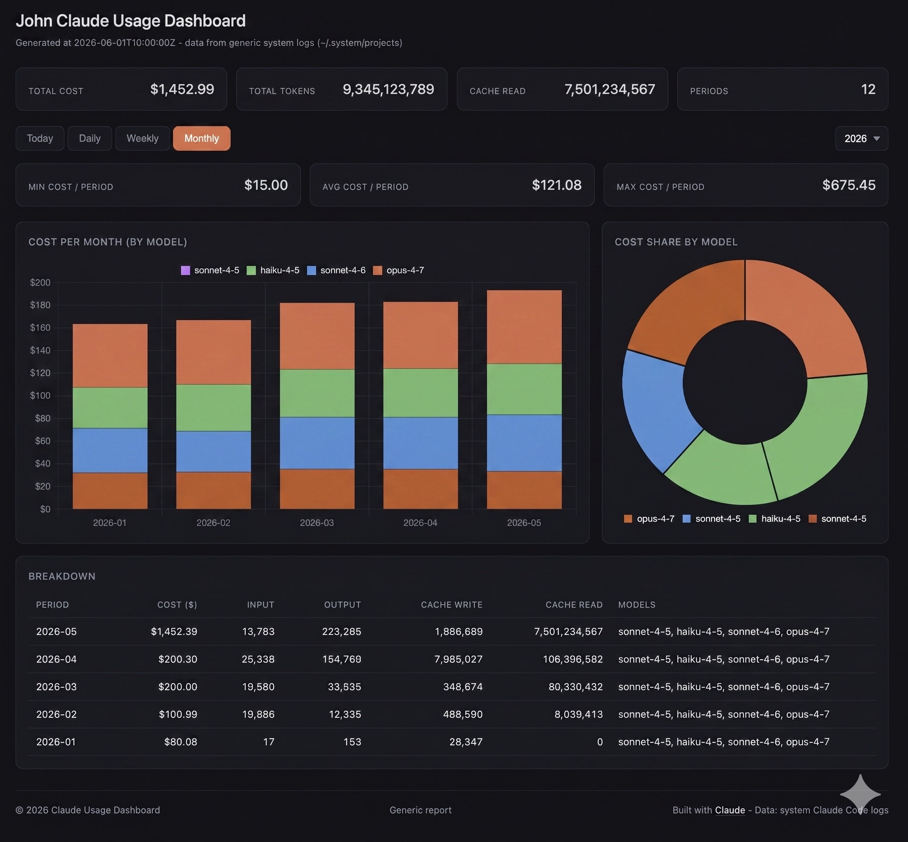

# ccusage-ui-dashboard

A local visual dashboard for **Claude Code** usage — cost, tokens, model split — across day / week / month / year.

> **Main feature:** type `/<prefix>-usage` inside any Claude Code session and get an inline cost & token summary _right in the chat_, plus the full visual dashboard opens in your browser — all without leaving your terminal.



The dashboard runs entirely on your machine. It reads the local Claude Code transcripts
(`~/.claude/projects/**/*.jsonl`) with a built-in reader — [`ccusage`](https://github.com/ryoppippi/ccusage)
is only an optional fallback — embeds the parsed data into a self-contained HTML file, and opens it in your browser.
No server, no telemetry, no external API calls — Chart.js is bundled into the generated file, so the dashboard also works offline.

## Features

- **`/<prefix>-usage` skill** (manual-only, never invoked by the model) — type it in any Claude Code session to get an inline cost & token summary in the chat and open the full visual dashboard in one step.
- **Time column** — how long you actually worked, in every table: per day, week, month, project and folder (`45m`, `3h 12m`, `5d 3h`; a day is 24 hours of activity). It is *active* time: the gaps between consecutive events of a session count as work when they are at most 10 minutes (`idleMinutes`), longer pauses count as being away; parallel sessions are counted once. `—` = not measured, `≥` = some days of that period were not measured.
- **Rate column** — right after Time: what an hour of work cost (`$12.34/h` = Cost ÷ Time). Only the cost of days whose time was measured is divided, so a period with unmeasured days is not skewed (it is marked `~`); `—` when there is no time to divide by or less than a minute of it (5 s of work and $0.16 would read $115/h). A folder row divides its summed cost by its summed time, so when sessions in sibling folders overlapped its rate is a little lower than the Total's.
- **Projects tab** — everything spent per project (the folder a message was written from) for 7 days / 30 days / 90 days / 1 year / all time. The table is a tree by folder: a row adds up everything below it, chains of folders are folded (`~/ok/code_p/app`), a folder with usage of its own lists it first, right under the folder, as ".. (this folder)", and branches holding at least 20% of the spend start open; click a row to open or close it. Columns as on Today plus the date of the last activity (a project that was quiet for months and came back shows both). The chart shows the 12 biggest folders by model and the rest as "+N more". Facts only — no forecasts or budgets.
- **Today by project** — the Today tab breaks the day down by the folder each message was written from (`ok/code`, `skills/amplify-pitch`): one table row and one stacked bar per project, split by model, most expensive first. Needs the built-in log reader.
- **Min / Avg / Max cost cards** per tab, with the date of the cheapest and the most expensive period (`Min cost / week · 2026-08-23`, `Avg cost / week · 6 weeks`): Daily, Weekly and Monthly look at every row of the table below (selected year); Today looks at the last 30 days (the days that had usage), since a single day has no spread.
- **Total row** at the top of the breakdown table: cost and token columns summed for the active tab and year, with the models ordered by what they cost.
- **Period tabs**: `Today` · `Daily` · `Weekly` · `Monthly`.
- **Year dropdown** (right of the tabs) — populated from all years available in your data.
- **Min / Avg / Max cost** per period for the active view.
- **Stacked bar chart** of cost per period, broken down by model, with **stable model colors** across all tabs (the priciest model always keeps the same color slot).
- **Doughnut** with cost share by model.
- **Detailed table** with input / output / cache-write / cache-read tokens per period.
- **Light / dark theme toggle** — sun/moon button in the header, preference persisted in `localStorage`.
- Inline markdown summary printed to stdout — Today / Last 7 days / This month / All time + top models by cost.
- **Works offline** — Chart.js is bundled into the generated file; only Node.js is required.
- **Week start follows your locale** — or set it in `config.json` (see [Configuration](#configuration)).
- **Long-term history** — Claude Code deletes transcripts older than 30 days (`cleanupPeriodDays`); the dashboard keeps its own text-free ledger (`history.json`: tokens and cost per 15-minute bucket and model), so past months stay in the charts and a later price change never rewrites what you already spent.
- **Built-in log reader** — no `ccusage` and no network needed; costs come from a price table that is refreshed once a day when you are online (cached next to `build.mjs`; the table bundled with the package is the fallback), the page shows the date the prices are from, and a model without a known price is flagged instead of silently counting as $0.

## Requirements

- Node.js ≥ 18 and a modern browser. Everything here is plain Node.js — no `bash`, `python3`, `npx` or `ccusage` needed for the default mode. Developed and tested on macOS; Linux and Windows use the same code but are untested.
- Optional: [`ccusage`](https://github.com/ryoppippi/ccusage) (12.4.0 – 20.x, resolved through `npx`; a globally installed one is used first) — only used when `source` is `ccusage`, or as the fallback when no usage records are found in the logs.
- Claude Code CLI installed (so that `~/.claude/` exists and the skill is picked up).

## Installation

### Option A — one-shot via `npx` from npm (recommended)

No clone required. Installs from the npm registry:

```bash
npx ccusage-ui-dashboard
```

Pass the prefix non-interactively:

```bash
CC_USAGE_PREFIX=ok npx ccusage-ui-dashboard
```

### Option B — one-shot via `npx` from GitHub

Pulls the package straight from GitHub — useful before an npm release:

```bash
npx github:okrasn/ccusage-ui-dashboard
```

Pin a tag/version if you want reproducibility:

```bash
npx github:okrasn/ccusage-ui-dashboard#v1.0.0
```

You can also pass the prefix non-interactively:

```bash
CC_USAGE_PREFIX=ok npx github:okrasn/ccusage-ui-dashboard
```

### Option C — clone and run setup

```bash
git clone https://github.com/okrasn/ccusage-ui-dashboard.git
cd ccusage-ui-dashboard
npm run setup
```

Either path triggers the same flow. `setup` first prompts for a
**prefix** (default `my`, so the skill is invoked as `/my-usage`;
pick anything matching `[A-Za-z0-9_-]+`, e.g. `ok` → `/ok-usage`). To skip the
prompt, pass it via env: `CC_USAGE_PREFIX=ok npm run setup`.

Then it runs the full cascade:

1. **`copy-dashboard`** — copies `build.mjs`, `lib/`, `vendor/` and `template.html` into `~/.claude/dashboard/` (or `$CLAUDE_CONFIG_DIR/dashboard/`).
2. **`copy-skill`** — writes the skill to `~/.claude/skills/<prefix>-usage/SKILL.md` (a `disable-model-invocation` skill: only you can run it).

After it finishes, open any Claude Code session and type:

```
/<prefix>-usage    # e.g. /my-usage or /ok-usage
```

You'll get an inline markdown summary in chat **and** the full visual dashboard
will open in your default browser.

### Step-by-step (if you prefer)

```bash
npm run copy-dashboard          # dashboard files → ~/.claude/dashboard/
CC_USAGE_PREFIX=my npm run copy-skill    # skill → ~/.claude/skills/my-usage/SKILL.md
```

`copy-skill` reads the prefix from `--prefix` or the `CC_USAGE_PREFIX` env var; without
either it prompts interactively (defaulting to a skill (or a pre-1.3 command) previously installed by this package,
or `my` on a fresh machine; non-interactive runs use that default). The variable is named
`CC_USAGE_PREFIX` deliberately — `PREFIX` collides with npm's own `--prefix` config.

It never overwrites a `<prefix>-usage` skill that this package did not install — pick another
prefix, or pass `--force`. A slash command that **this package** installed before 1.3
(`~/.claude/commands/<prefix>-usage.md`) is removed and replaced by the skill. Pass `--force` to either step to reinstall the same version — with npm scripts put it after a separator
(`npm run setup -- --force`); without `--`, npm keeps the flag for itself and the installer just reports "skipping".

### Optional — shell alias

Add to `~/.zshrc` (or `~/.bashrc`):

```bash
alias <prefix>-usage='node ~/.claude/dashboard/build.mjs'
```

Reload the shell, then run `<prefix>-usage` from anywhere to rebuild and open the dashboard.

## Usage

### From the terminal

```bash
node ~/.claude/dashboard/build.mjs                          # rebuild + summary + open browser
node ~/.claude/dashboard/build.mjs --no-open                # rebuild + summary, no browser
node ~/.claude/dashboard/build.mjs --no-summary             # rebuild + open, no summary
node ~/.claude/dashboard/build.mjs --no-open --no-summary   # silent rebuild
node ~/.claude/dashboard/build.mjs --help                   # all options (--out, --template, --config)
```

Each run regenerates `~/.claude/dashboard/index.html` with fresh data.

### Configuration

Optional `config.json` next to `build.mjs` (`~/.claude/dashboard/config.json`; never overwritten by upgrades):

```json
{
  "weekStart": "monday",
  "source": "auto",
  "priceRefresh": "daily",
  "history": "on",
  "projects": "on",
  "time": "on",
  "idleMinutes": 10,
  "prices": { "claude-new-model-1": { "input": 3, "output": 15, "cacheWrite": 3.75, "cacheRead": 0.3 } }
}
```

- `weekStart` — `auto` (default: follows your system locale), or `sunday` … `saturday`. Weeks are
  computed locally from daily data, so they always follow this setting regardless of the ccusage version.
  Note: `auto` uses the locale's region default; a custom "first day of week" set in the OS
  calendar settings is not visible to Node, so set it here explicitly if it differs.
- `source` — `auto` (default): read the Claude Code logs, fall back to ccusage when there are no usage records;
  `logs`: logs only (error if none); `ccusage`: always use ccusage. Override per run with `build.mjs --source <name>`.
  Logs are looked up in `$CLAUDE_CONFIG_DIR` (comma-separated), otherwise `~/.config/claude/projects` and `~/.claude/projects`.
- `priceRefresh` — `daily` (default): the first run of each day downloads the public price table
  (LiteLLM's `model_prices_and_context_window.json` from GitHub, ≈3 MB) into `prices-cache.json` next to `build.mjs`;
  the other runs that day use the cache. `off`: never download (the cache, if any, and the table bundled with
  the package are used). Offline or after a failed download the newest prices available are used and the page
  says which date they are from ("prices as of …", "outdated" after a week); a failed download is not retried for
  an hour, and a model without a price triggers one extra attempt.
  `priceUrl` — optional alternative `http(s)` URL of a LiteLLM-format table (a mirror).
  Force a refresh any time: `node ~/.claude/dashboard/build.mjs --refresh-prices` (an alias such as `ok-usage`
  passes the flags through); `--offline` skips the download for one run.
- `history` — `on` (default) keeps `history.json` next to `build.mjs`; `off` disables it (the dashboard then shows only
  what the Claude Code logs still contain). The ledger holds, per 15-minute UTC bucket, project and model, the token counts
  and the **cost in USD as priced when the bucket was first seen** — no prompts; project folders only (see `projects`). A later price change
  does not touch recorded buckets; a bucket that grows is charged only for its growth. A model that had no price is
  stored without cost and priced as soon as a price is known. The first run converts the logs that exist at that
  moment (priced with the current table); after that the file is the long-term record — **include it in your
  backups**. A previous version is kept as `history.json.bak`, a corrupt file is moved aside (never overwritten),
  and a file from a newer version is only read. `build.mjs --reset-history` rebuilds it from the current logs
  (the old file stays as `.bak`; days that only exist in the old file are dropped from the new one).
  It does not apply to `source: ccusage`.
- `projects` — `on` (default): record, for every message, the working directory it came from (shown relative to your
  home as `~/ok/app`) so the Today tab can split the day by project. `off`: no paths are read, stored or embedded and
  Today shows the plain period layout. If you change this after `history.json` exists, run `build.mjs --reset-history`
  once so the ledger does not mix attributed and unattributed rows for the same moments.
- `time` / `idleMinutes` — `time: "on"` (default) measures active time and adds the **Time** column; `idleMinutes`
  (1–240, default 10) is the longest pause between two events of a session that still counts as work. Raise it and
  the numbers grow (on one real day: 5 min → 3.8 h, 10 min → 4.8 h, 30 min → 5.8 h). Changing it affects what is
  measured from then on; time already stored in `history.json` is kept (a bucket only ever grows). `"time": "off"`
  hides the column and stops reading timestamps.
- `prices` — USD **per million tokens** for models that are missing from the bundled table (`input`, `output`,
  `cacheWrite`, `cacheRead`); they also override the bundled values. A model without any price is shown with a
  warning and counted as $0.

### From Claude Code — `/<prefix>-usage`

Inside any Claude Code session:

```
/<prefix>-usage    # e.g. /my-usage or /ok-usage
```

It will:

1. Run `build.mjs` to rebuild the dashboard with fresh data.
2. Render the markdown summary inline in the chat (Today / Last 7 days / This month / All time + top models).
3. Open the full visual dashboard in your default browser.
4. If launched from a VS Code integrated terminal, also print a tip with a
   ready-to-paste `file://` URL for VS Code's **Simple Browser** (`Cmd+Shift+P` →
   `Simple Browser: Show`) — for viewing the dashboard in a side tab inside
   VS Code instead of a separate browser window.

> The name comes from the prefix you chose at setup time — the skill lives in
> `~/.claude/skills/<prefix>-usage/`. Re-run `npm run setup` with a different
> `CC_USAGE_PREFIX` to add another (the previous one is left in place).

> **Why not auto-open in Simple Browser?** The `code` CLI does not expose a way to
> invoke arbitrary VS Code commands like `simpleBrowser.show` from a script. The
> printed URL is the most reliable cross-version solution without writing a
> custom VS Code extension.

## Available npm scripts

| Script                   | What it does                                                                          |
| ------------------------ | ------------------------------------------------------------------------------------- |
| `npm run setup`          | Prompts for command prefix (default `my`), then runs the full setup cascade           |
| `npm run copy-dashboard` | Copies the dashboard files into `~/.claude/dashboard/` (version-aware)                |
| `npm run copy-skill`     | Writes `~/.claude/skills/<prefix>-usage/SKILL.md` (uses `CC_USAGE_PREFIX` env or prompts); `copy-command` is a kept alias |
| `npm run build`          | Renders **this repo's** `template.html` to `./index.html` and opens it (dev loop)     |
| `npm start`              | Same as `npm run build`                                                               |
| `npm test`               | Runs the unit tests (`node --test`, no dependencies)                                  |
| `npm run prices:update`  | Dev: refreshes the bundled `vendor/prices.json` (release-time baseline) from LiteLLM's public table (`-- --check` to preview) |
| `npm run verify:ccusage` | Dev: compares the built-in reader with ccusage on **your** logs, per day and model (`-- --ccusage-version 20.0.26`) |

> The installer compares the version in [`package.json`](./package.json)
> against the version recorded next to the installed files (`.version` /
> `.<prefix>-usage.version`). It overwrites only when the package version is
> strictly newer (prereleases sort below their release); otherwise it skips —
> pass `--force` to reinstall.

## Repo layout

```
ccusage-ui-dashboard/
├── package.json              # npm package manifest (declares `bin` for npx)
├── README.md                 # this file
├── build.mjs                 # generator: logs (or ccusage) → prices → embed → open + summary
├── lib/                      # log reader, pricing, source selection, ccusage runner + adapter, aggregation, rendering, summary, installer
├── template.html             # UI template (__DATA__, __USER_NAME__, __CHARTJS__ placeholders)
├── vendor/                   # Chart.js 4.4.6 (MIT) inlined into the HTML; prices.json = bundled price table
├── bin/
│   └── install.mjs           # npx entrypoint (`npx ccusage-ui-dashboard`) and `npm run setup`
├── skill/
│   └── SKILL.md              # Claude Code skill template (manual-only)
├── scripts/                  # dev tools, not published: update-prices.mjs, verify-ccusage.mjs
└── test/                     # node:test unit tests
```

After running `npm run setup` on a new machine, the installed layout is:

```
~/.claude/dashboard/
├── build.mjs, lib/, vendor/, template.html
├── config.json               # optional, yours — never overwritten
└── index.html                # generated on each build

~/.claude/skills/
└── <prefix>-usage/SKILL.md   # makes /<prefix>-usage available in Claude Code (+ .version marker)
```

## Customisation

- **Colors** — edit the `COLORS` array in `template.html` (`<script>` block).
- **Footer / branding** — `<footer class="footer">` in `template.html`.
- **Title** — `<title>` and `<h1>` in `template.html`.
- **What min/avg/max measure** — currently `totalCost` per period; swap to
  `totalTokens` in the `render()` function if you prefer a token-based stat.
- **Inline summary contents** — edit `lib/summary.mjs` to add/remove rows or change
  formatting. The output goes straight into Claude Code's chat via `/<prefix>-usage`.
- **Skill behavior** — edit `skill/SKILL.md` (in this repo) to
  change what Claude does alongside the summary, then rerun
  `CC_USAGE_PREFIX=<your-prefix> npm run copy-skill -- --force` (or just
  `npm run copy-skill` to be re-prompted) to redeploy. To switch the prefix,
  run setup again with a different `CC_USAGE_PREFIX`.

> **Heads up:** if you customise files inside `~/.claude/dashboard/` directly
> (not in this repo), a newer version of this package will overwrite them on the next
> `copy-dashboard` (only `config.json` is preserved). Treat this repo as the source of truth
> and edit here — `npm run build` previews your repo changes without installing anything.

## Privacy

All data stays local. The generated HTML makes no network requests (Chart.js is inlined). The generator's only
network access is the daily download of the public price table (no usage data is ever sent; set
`"priceRefresh": "off"` to disable it) and, if you use the ccusage source, `npx` fetching ccusage. The reader opens your transcript files but keeps only the model name, timestamp and the
four token counts of each assistant message — prompt and response text is never stored or embedded. `history.json`
contains only dates, model names, **project folders** (relative to your home), token counts and costs; the page embeds
the whole history of the same (about 0.4 MB per year of heavy use; mind this when you screen-share, or set `"projects": "off"`). 

## Changelog

### v1.3.0

Two changes: `/<prefix>-usage` is now a **skill**, and the dashboard reads your Claude Code logs itself instead of depending on ccusage. How you call it does not change.

**Added — built-in log reader (default)**
- Reads `~/.claude/projects/**/*.jsonl` directly (also `$CLAUDE_CONFIG_DIR`, `~/.config/claude`). No `ccusage`, `npx` or network needed; a run takes ≈0.6 s versus ≈2.4 s via ccusage and ≈6 s for 1.1.x (maintainer's machine, 23 days of data).
- Verified against ccusage on real logs: **39 of 39** (day, model) cells identical in all four token counts and in cost with ccusage 19.0.3 and 20.0.26 (`npm run verify:ccusage`).
- Cost comes from LiteLLM's public price table: **refreshed once a day** when online and cached in `prices-cache.json`, with the table bundled in the package (`vendor/prices.json`, 22 Claude models as of 2026-10-08) as the baseline — so it works fully offline, with prices as fresh as your last online day. The page shows "prices as of <date>" (and warns when they are over a week old); the chat summary adds a note when they were not refreshed today. A model without a price is **flagged** (banner, warning) rather than silently priced at $0; add rates under `prices` in `config.json`. New: `priceRefresh`, `priceUrl`, `--refresh-prices`, `--offline`.
- New `source` option (`auto` | `logs` | `ccusage`) in `config.json` and `build.mjs --source`; `auto` falls back to ccusage when no usage records are found.

**Added — Time column (active time)**
- Every table gets a **Time** column after Cache read: the time you were actually working, measured from the timestamps of the Claude Code transcripts. Pauses longer than `idleMinutes` (default 10) are not counted, parallel sessions in one folder are counted once, and the Total row is the real time (work in two folders at once counts once there, but in both folder rows). Format `45m`, `3h 12m`, `5d 3h`. It is stored per 15-minute bucket in `history.json` (schema 3; older files are read and extended), so it survives Claude Code's transcript cleanup. New options `time` and `idleMinutes`. Reading the timestamps means parsing every transcript line (≈ +0.1 s on 130 MB of logs); message text is not stored.

**Added — Rate column (Cost ÷ Time)**
- Every table gets a **Rate** column after Time: the cost of one hour of active work, `$/h`. The numerator is the cost of just the days that have a measured time (a day with usage but no time data would otherwise inflate the rate); a period with such days shows `~ $x/h`, no time or under a minute of it shows `—`. The Total row divides by the real, united time. Hidden together with Time (`"time": "off"`, ccusage source).

**Added — privacy mode (the eye)**
- An eye button next to the theme toggle. Open (default) shows everything as before; click it and it closes: every project name on screen is replaced by `****` per path segment (`~/ok/code_p/app` → `~/****/****/****`) — in the Today and Projects tables (including the hover path), the chart axis and tooltips, and the Min / Max cards. Folder structure, numbers, `~`, `.. (this folder)`, `(unattributed)` and `+N more` stay, so you can show the dashboard without showing what you work on. The choice applies to all tabs and is not remembered: every newly generated or reloaded page starts with the eye open. The button is hidden when the page has no project data.
- It masks what is *displayed*, it is not encryption: the generated `index.html` still contains the names (view-source, saving the file), so share a screenshot or a screen share, not the file.

**Changed — generation time in local time**
- The sub-line reads `Generated at 2026-10-09 01:28:52 GMT+3` (your local date and time with the zone offset, e.g. `GMT+5:30`, `GMT`) instead of a UTC ISO stamp, so you can tell when the report was made without adding or subtracting hours.

**Added — average line on the bar chart**
- The cost chart gets a thin dashed red line labelled `Avg $x` at the value of the Avg card, so every bar reads as above or below average. It always sits at the value of the Avg card: `Avg $x` on Daily, Weekly, Monthly and Today (also on Today by project, where it is the daily average), `Avg / project $x` on Projects. The cost axis is stretched to reach the line when every bar is lower. On Today by project the first bar is **Total** (all projects, stacked by model), so you can see at a glance whether today as a whole is still under the average line.

**Changed — compact token counts, no wrapping**
- Input / Output / Cache write / Cache read in the tables are shown compactly (`842`, `10.2k`, `4.3M`, `1.4B`; the exact number is the cell's tooltip), and the Time, Rate and Last activity cells never wrap, so every row keeps its height on a narrow window (only the Models column wraps).

**Added — Projects tab**
- New **Projects** tab with the period chips 1d (today) / 7d / 30d / 90d / 1y / All (default All): a per-project cost table shaped as an expandable folder tree (ancestors add up their descendants; `~` is not a project, so its children are the top level; paths outside the home folder form their own roots; usage without a working directory is "(unattributed)"), the Total row, a chart of the biggest folders by model with a "+N more" bar, the model doughnut, and Min / Avg / Max cost per project. The tab is hidden when project data is not available (ccusage source or `"projects": "off"`). Project rows now cover the whole history, not only 31 days.

**Added — Today by project**
- On the Today tab the table lists the projects you worked in today (the working directory of each message, relative to `~`; two path parts, e.g. `ok/code`, longer only when two projects would look the same), most expensive first, under the Total row; the chart becomes "Cost per project today (by model)" with one stack per project (axis labels longer than 20 characters are clipped with "…"; hover a bar for the full path). Min/Avg/Max keep showing the last 30 days. With no usage yet today the table says so. `history.json` moves to schema 2 (per-project rows); a file from the earlier build is migrated automatically — rows that the current logs still cover are replaced by project-attributed ones, older rows are kept as "(unattributed)" with their recorded cost. New option `projects`.

**Added — durable history**
- Claude Code removes transcripts older than 30 days by default, which is why the dashboard used to show only the last month or two. `history.json` (see Configuration) now keeps usage and its cost past that cleanup, per 15-minute UTC bucket (so a time-zone change cannot double-count) and model. Cost is recorded when a bucket is first seen and never re-priced; growth is charged at the then-current prices. Older data that Claude Code has already deleted cannot be recovered. New: `history` option, `--reset-history`.

**Fixed**
- A week that crosses New Year is split in two (e.g. `2025-12-29` and `2026-01-01`), each part in its own year. Before, its January days were listed under the previous year in the Weekly tab, so a year's Weekly total did not match its Daily and Monthly totals, and the year drop-down could offer a year with no days in it. Boundary weeks are therefore partial.
- Duplicate streaming entries are collapsed to the final one (≈50% of assistant lines in real logs are partial duplicates). ccusage ≤ 18 keeps the *first* one and under-counts output tokens — on the maintainer's data 322,876 output tokens (≈1.2% of cost). This explains the difference between ccusage 18 and 19+ noted under 1.2.0; the built-in reader matches 19+. **Numbers can therefore go up by about that much compared to 1.2.0 on the same logs.**

**Changed**
- The four summary cards at the top (total cost, total tokens, cache read, periods) are gone: their numbers are now the first, highlighted **Total** row of the breakdown table (sums per column for the current tab and year; total tokens is the sum of the four token columns; the number of periods is in the Avg card). Min / Avg / Max cost cards are now meaningful on every tab: Daily, Weekly and Monthly cover all rows of the table (selected year) and name the date / week start / month of the minimum and maximum; Today covers the last 30 calendar days (days that had usage) instead of showing the same number three times.
- Installed as `~/.claude/skills/<prefix>-usage/SKILL.md` with `disable-model-invocation: true` — Claude never invokes it on its own and, per the Claude Code docs, a skill with that flag is kept out of the model's context. Custom commands are the deprecated predecessor of skills.
- The skill body uses the documented injection form `` !`cmd` `` instead of a bare `!cmd` line.
- New `npm run copy-skill` / `--skill`; `copy-command` / `--command` stay as aliases.

**Upgrading from 1.2.x**
- Re-run setup. A command that this package installed (`~/.claude/commands/<prefix>-usage.md`) is removed and replaced by the skill. A skill or command with the same name that this package did not create is never overwritten without `--force`; a foreign command with that name is reported as a name collision (which one wins is not documented — remove one).

**Known**
- Pricing limits: the 1-hour cache-write rate (kept in the snapshot) is not applied — all cache-creation tokens use the 5-minute rate, like ccusage; long-context surcharges are not modelled (two older models, `claude-sonnet-4-5*`, are marked `"tiered"` in the snapshot); fast mode and web-search fees are not modelled. None of these showed up in the verification data.
- The ledger prices a bucket when the dashboard first sees it: if you run it rarely, activity from the days in between is priced with the table available at that run (the latest one, refreshed daily when online).
- **Time is only known for what the dashboard has seen**: days older than Claude Code's transcript retention that were already in `history.json` before this version have no time (`—`), and a day whose transcripts were partly cleaned up shows only what was left. A folder row adds up its subfolders' time, so work in two sibling folders at the same moment counts in both rows (the Total is the real figure). The measure is activity, not effort: reading a long answer without sending anything for more than the idle threshold is not counted.
- The project is the message's own working directory, so a session that `cd`s around shows up as several rows (e.g. a repo and its `test` folder), and `~/.claude/skills/...` helper work is listed separately. A folder you start sessions from but work in other repositories (like a workspace root) is one row of its own (".. (this folder)") — the logs cannot say which repository the work was about.
- A change of the Claude Code log format would need a reader update; set `source` to `ccusage` as a workaround.
- Claude still produces a short reply after the dashboard output is injected (documented behaviour for skills); `model:`/`effort:` pinning to make it cheaper is not used because it is not in the official skills reference.

### v1.2.0

Rewritten in Node.js, compatible with current ccusage, and hardened. The command name, `--no-open` / `--no-summary` flags, `CC_USAGE_PREFIX` and the install locations are unchanged.

**Fixed — it broke on current ccusage**
- With ccusage 19.x / 20.x (what `npx` fetches when ccusage is not installed globally) 1.1.x failed with `KeyError: 'date'` after writing an unusable `index.html`. It now reads the Claude-only report (`ccusage claude daily`) and falls back to `ccusage daily` for older versions. Tested end-to-end with ccusage 12.4.0, 15.10.0, 17.2.1, 18.0.11, 19.0.3 and 20.0.26 — identical days / weeks / months / models on the same logs.
- Unexpected ccusage output now stops with a readable message instead of rendering an empty $0 dashboard.
- The generator no longer fails on long histories (1.1.x hit the OS argument limit at roughly 1,000–1,500 days with usage, measured with synthetic data).
- "Last 7 days" in the chat summary covered 8 days; it is now 7 (today + previous 6).
- A failed browser launch no longer fails the build (and `open` is no longer macOS-only).
- The dashboard no longer renders blank when `localStorage` is unavailable.

**Security**
- Embedded data and names are escaped. In 1.1.x a model name containing `</script>` broke out of the data block and executed injected script (reproduced in Chrome); the new build renders it as text. The installer also refuses to overwrite a `<prefix>-usage.md` it did not create.

**Added**
- `config.json` next to `build.mjs` — `weekStart`: `auto` (follows your system locale), or `sunday` … `saturday`.
- The package version in the dashboard footer.
- Generator options `--out`, `--template`, `--config`, `--help`; installer flags `--prefix`, `--force`, `--dashboard`, `--command`; `$CLAUDE_CONFIG_DIR` is honoured.
- Unit tests (`npm test`, 35 tests, no dependencies).

**Changed**
- Generator and installer are now Node.js (`build.mjs`, `lib/`, `bin/install.mjs`) — no `bash` or `python3` required.
- One ccusage call instead of three; weekly and monthly rows are computed locally from daily data, so weeks follow your `weekStart` regardless of the ccusage version. On the maintainer's machine (23 days of data, ccusage 18) a run went from ≈6.1 s to ≈2.3 s (median of 5 alternating runs; timings vary by machine).
- Chart.js 4.4.6 is bundled into the generated HTML: the page loads no external resources and works offline. The generated file grows from ≈34 KB to ≈239 KB; the npm package from ≈302 kB to ≈379 kB.
- `npm run build` renders the repo's own `template.html` to `./index.html` (previously it re-rendered the *installed* copy).
- The unused `ccusage` dependency was removed from `package.json`.
- Installer versions compare as semver (`1.2.0-beta.1` no longer outranks `1.2.0`).

**Upgrading from 1.1.x**
- Re-run `npx ccusage-ui-dashboard@latest` (or `npm run setup`). `~/.claude/dashboard/build.sh` is kept as a one-line shim that runs `build.mjs`, so existing skills, symlinks and shell aliases keep working; fresh installs do not create it.
- Unknown `build` options are now rejected (1.1.x silently ignored them).
- If a `<prefix>-usage.md` was not installed by this package, setup stops with an error; choose another prefix or pass `--force`.

**Known limitations**
- On the same logs, ccusage 19.x / 20.x report about 1.2% higher cost than 12.x–18.x (measured: $483.47 vs $477.62). This is ccusage's own accounting; the cause was not investigated.
- Developed and tested on macOS. Linux and Windows use the same code but are untested. The `npx github:…` install path (Option B) has not been tested under npm 12's `--allow-git` default.

### v1.1.1

- Slash command no longer registered as a skill — `/<prefix>-usage` is now a pure slash command, removing the model-trigger overhead on every invocation.
- Removed the post-bash instruction prompt from the command file, so the model no longer generates a response after running the bash script.

### v1.1.0

- **Light / dark theme toggle** — sun/moon button in the dashboard header; chart colors update on switch; preference persisted in `localStorage`.
- Slash command prompt trimmed to reduce token usage on each `/<prefix>-usage` invocation.

### v1.0.0

Initial public release.

- Self-contained HTML dashboard (no server, no telemetry).
- `/<prefix>-usage` Claude Code slash command — inline cost summary in chat + visual dashboard in browser.
- KPI cards (total cost, tokens, cache reads, periods) + min/avg/max per period.
- Period tabs: Today / Daily / Weekly / Monthly with year filter dropdown.
- Stacked bar chart + doughnut (cost by model, stable color slots across tabs).
- Detailed breakdown table (input / output / cache-write / cache-read tokens).
- `npx ccusage-ui-dashboard` one-shot install from npm.
- `--no-open` and `--no-summary` flags for `build.sh`.
- VS Code Simple Browser tip when running inside a VS Code terminal.

## Licence

MIT — see [`LICENSE`](./LICENSE).
